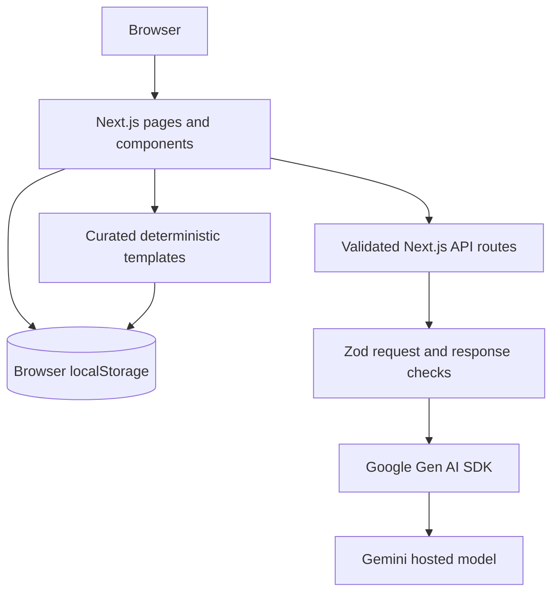

# TouchGrass AI

**Less scrolling. More exploring.** A local-first outdoor adventure companion that plans small, practical missions and helps you put your phone away.

> Hosted Gemini inference is optional and requires internet. The curated mission library, saved adventures, active mission, completion log, reflections, and exports work locally without a Gemini key. There is no local AI model.

## Features

- Responsive landing page, adventure discovery and details, distraction-free step mode, nature learning, garden planning, local journal, impact dashboard, and privacy settings.
- 24 curated, deterministic fallback missions; filtered by duration, interests, and environment.
- Gemini-only optional generation and learning endpoints, with server-only credentials and bounded inputs.
- Local storage for saved and active missions and journal notes. No account, journal upload, or automatic location access.
- Clear distinction between Gemini recommendations and curated templates.

## Screenshots

_Add screenshots of the landing page, adventure mode, and journal here after capturing the running app._

## Stack

Next.js App Router, TypeScript, Tailwind CSS 4, React, Lucide, Zod, official `@google/genai` SDK, and Vitest. UI primitives are implemented in the project rather than depending on a shadcn/ui package. No database or paid infrastructure is required.

## Architecture



## Run locally

```bash
npm install
cp .env.example .env.local
npm run dev
```

Open `http://localhost:3000`. The app works without credentials; generation falls back to curated templates. To enable Gemini, add a server-side key in `.env.local`:

```dotenv
GEMINIAPIKEY=yourapikey_here
GEMINI_MODEL=gemini-2.5-flash
```

`GEMINIAPIKEY` is never prefixed with `NEXT_PUBLIC_`. The default model can be overridden with a currently supported Gemini model ID. Nature and garden endpoints also require this setting and report a helpful configuration error otherwise.

## Routes

| Route | Purpose |
| --- | --- |
| `/` | Product landing page |
| `/discover` | Preference form, Gemini generation, and offline fallback |
| `/adventures/[id]` | Complete plan, safety, preparation, and save action |
| `/adventure-mode/[id]` | Minimal step-by-step mission with locally persisted progress |
| `/nature` | Cautious educational explanations via Gemini |
| `/garden` | Gardening plan via Gemini |
| `/journal` | Local completions, reflections, search, export, and deletion |
| `/impact` | Metrics derived only from completed local missions |
| `/settings` | Privacy, local data, and connection information |

Server endpoints: `POST /api/adventures/generate`, `POST /api/nature/explain`, and `POST /api/garden/plan`.

## Testing

```bash
npm test
npm run build
```

Schema tests cover template validity, bounds, and deterministic filtering. Manual verification is still needed for real Gemini credentials, outdoor safety, and browser offline behavior.

## Privacy and data

Adventure preferences are validated and sent only to the server route when the user requests generation. Location is optional free text; device geolocation is never requested. Journal entries, saved plans, and mission progress remain in browser local storage. Clearing browser site data removes them; Settings and Journal also provide export and clear actions. Gemini is a hosted AI service: inference requires internet and the submitted prompt data is sent to Google for processing. Do not submit sensitive information.

The interface requires the app shell to have been loaded first to work offline. Selected missions and their progress, completed records, notes, and data export use local storage. Gemini generation, nature explanations, and garden plans require internet. This version does not bundle a service worker or claim full PWA shell caching.

## Demo flow (2–3 minutes)

1. Open the landing page and choose **Find My Adventure**.
2. Set 15 minutes and choose a nature interest; generate three Gemini ideas if credentials are configured. Without a key, show the explicit curated fallback.
3. Open a mission, review safety and preparation, and start Adventure Mode.
4. Advance steps, refresh once to show persisted progress, then finish the mission.
5. Add a reflection in Journal and show the Impact dashboard metrics.
6. Save a mission, disable connectivity after the app is loaded, and reopen that saved mission. Do not imply that an actual outdoor test occurred unless one was completed and documented.

## Deployment and limitations

Deploy as a Node-capable Next.js application and configure `GEMINIAPIKEY` and optionally `GEMINI_MODEL` in the hosting provider's server-side environment settings. Use HTTPS. The application includes basic payload bounds and safe error messages, but production deployment should add provider-level rate limiting and abuse monitoring appropriate to its traffic. It does not verify weather, routes, opening hours, identities, or local planting dates. User-supplied conditions are not independently checked.

No open-source license is declared in this starter repository. Gemini and its API have separate Google terms; the model/API is hosted and is not described here as open source or open weight.
